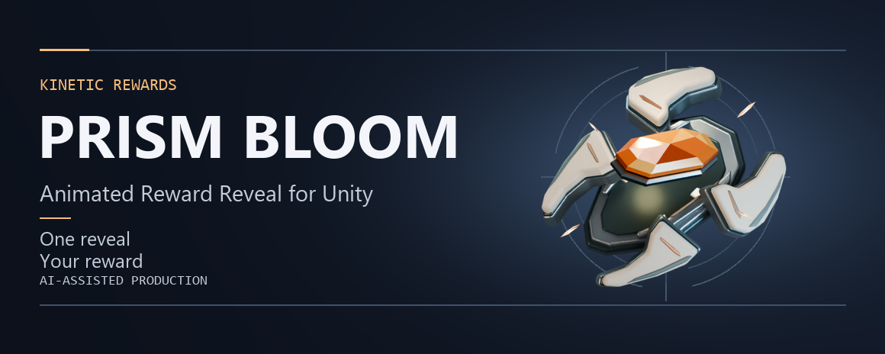
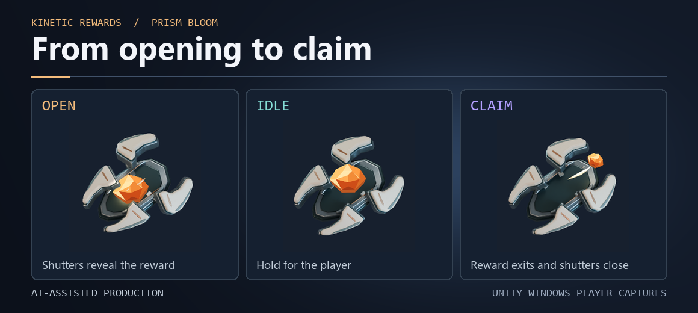
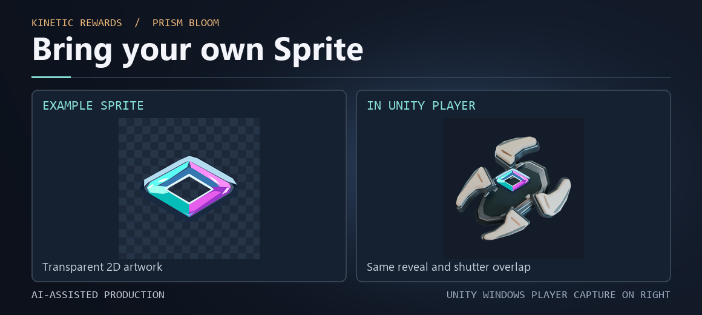

# Prism Bloom — Animated Reward Reveal for Unity

Add a reusable reward reveal to your Unity uGUI Canvas. Pick one of three included rewards or assign your own transparent Sprite, then control the reveal from C#.

[Watch the 18.4-second Showcase](media/Prism_Bloom_Showcase_FINAL_Silent.mp4) · [Integration overview](docs/INTEGRATION_OVERVIEW.md) · [Availability and beta interest](docs/AVAILABILITY.md)

The preview uses the approved picture edit without audio. Open the MP4 directly if your browser does not play it in the repository view. Material close-ups are labeled source renders. The interaction and Inspector shots are actual Unity captures.

## What it does

OPEN reveals the reward, IDLE holds it in view, and CLAIM plays the transfer when the player is ready. Reset closes the mechanism for reuse. Four shutters and authored visibility masks keep the layering when you swap the Sprite. Your game controls eligibility, grants, and inventory.

The asset includes one screen-space uGUI prefab, an interactive demo scene, English documentation, and **Helion Crest**, **Tide Key · Interlock**, and **Flux Cache · Gimbal Vault**. The reward slot accepts a Unity 2D Sprite. The baked Helion Core artwork is the fallback for an empty slot.

## Technical snapshot

| Area | Detail |
| --- | --- |
| Verified setup | Windows x64, Unity 6.3 LTS 6000.3.28f1, uGUI 2.0.0, Gamma color space |
| UI | Screen Space - Overlay and Screen Space - Camera tested. |
| Playback | Authored at 30 fps on a 512 × 512 px reference canvas. Active, enabled playback uses unscaled time. |
| API | `PlayOpen()`, `TryClaim()`, `ResetToClosed()`, `SetRewardSprite(Sprite)`, `Opened`, and `Claimed`. |
| Art input | Unity Sprite with alpha. Runtime 3D model insertion and automatic relighting are outside the slot's scope. |
| Verification limits | URP, HDRP, Android, mobile GPU, World Space, other operating systems, and other Unity versions remain unverified. |

## Contact and closed beta

Use **Issues → New issue** and choose **Closed beta interest** to describe a reward flow you would test, or **Product or compatibility question** to ask about integration or the tested setup. GitHub issues are public. Keep contact information, logs, and private project details for a private channel agreed with the maintainer.

The evaluation is free and private after an individual invitation. The showcase is open to browse. [Beta, contact, and purchase status](docs/AVAILABILITY.md)

**AI assistance.** OpenAI Codex assisted with procedural art and Blender scripting, Unity implementation, QA automation, documentation, and marketing production. This showcase contains preview media and public integration notes. Package access follows separate distribution terms.
